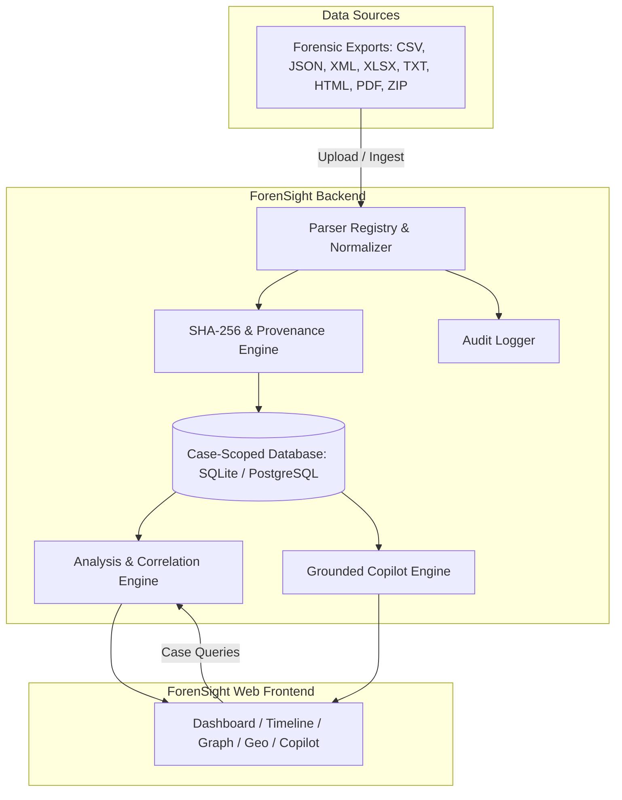
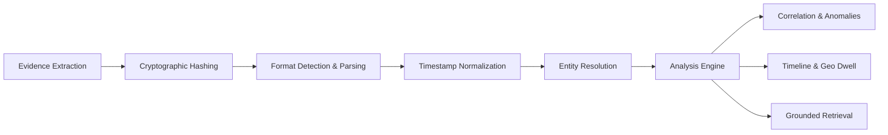
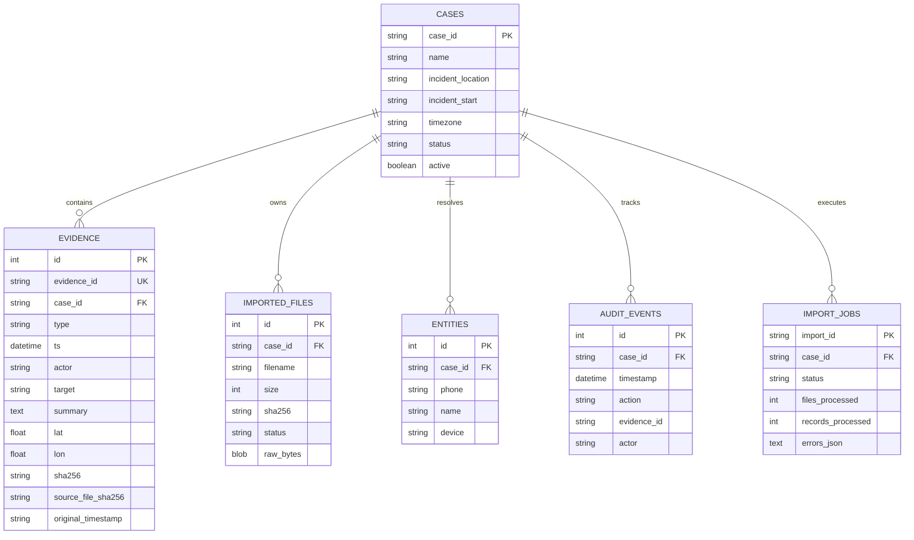

# Software Requirements Specification (SRS)
## ForenSight AI · Forensic Intelligence Platform

**Document Version:** 1.0.0  
**Status:** Approved / Baseline  
**Standard:** IEEE Std 830-1998 / ISO/IEC/IEEE 29148:2018  
**Date:** 2026-11-25  

---

## 1. Introduction

### 1.1 Purpose
This Software Requirements Specification (SRS) document details the complete functional and non-functional specifications for **ForenSight AI**. ForenSight is an evidence-analysis, correlation, and timeline-reconstruction platform designed for forensic investigators, digital analysts, and incident response personnel. It specifies the requirements for parsing heterogeneous digital exports, preserving strict cryptographic chain-of-custody, performing cross-artifact correlation, computing geospatial dwell and geofence events, constructing entity communication graphs, and providing evidence-grounded investigative assistance.

### 1.2 Scope of the System
ForenSight is an **analysis and correlation platform** that ingests previously acquired digital evidence exports. 
- **In-Scope:** Ingesting structured and semi-structured forensic exports (CSV, JSON, XML, XLSX, TXT, HTML, PDF, ZIP), cryptographic verification (SHA-256), timestamp normalization across timezones, entity resolution, timeline reconstruction, communication network analysis, geospatial tracking with dwell-time identification, deterministic query retrieval with citation provenance, and tamper-evident audit logging.
- **Out-of-Scope:** Physical forensic acquisition/imaging from locked devices, live hardware memory dumping, OCR on scanned document images, automated legal culpability determination, and proprietary closed-source forensic container decoding (e.g., proprietary Cellebrite UFED/EnCase formats without standard export).

### 1.3 Definitions, Acronyms, and Abbreviations
| Term / Acronym | Definition |
| :--- | :--- |
| **API** | Application Programming Interface (FastAPI RESTful service) |
| **Audit Event** | Immutable record detailing an action performed within the system |
| **Chain of Custody** | Cryptographic and procedural record documenting evidence intake, transformation, and access |
| **Dwell Time** | Period during which an entity remains within a bounded geospatial radius (≤ 150m for ≥ 20min) |
| **Entity** | A resolved human actor, phone number, handle, or digital account within a case |
| **Evidence ID** | Globally unique identifier (e.g., `EVD-2026-000123`) bound to an ingested record |
| **Geofence** | Defined circular geographic boundary (center latitude/longitude and radius in meters) |
| **Grounded AI** | AI assistance constrained to retrieve and cite actual case records without hallucinations |
| **IEEE 830** | Recommended Practice for Software Requirements Specifications |
| **IST** | Indian Standard Time (UTC+05:30), the baseline incident timezone |
| **SHA-256** | Secure Hash Algorithm 256-bit cryptographic digest |
| **Provenance** | Complete traceability record linking derived insights back to original raw file bytes |

### 1.4 References
1. IEEE Std 830-1998: *IEEE Recommended Practice for Software Requirements Specifications*.
2. ISO/IEC 27037:2012: *Guidelines for identification, collection, acquisition and preservation of digital evidence*.
3. ForenSight System Architecture Documentation (`docs/ARCHITECTURE.md`).
4. ForenSight Project Operational Readme (`README.md`).

---

## 2. Overall Description

### 2.1 Product Perspective
ForenSight operates as an offline-first forensic workbench. The system architecture partitions duties into an asynchronous Python FastAPI analytical backend and a lightweight, zero-dependency browser frontend.

### 2.2 User Classes and Personas
1. **Lead Forensic Investigator:** Primary reviewer responsible for establishing timelines, reviewing suspect movements, validating alibis, and submitting court-admissible manifests.
2. **Digital Forensic Technician:** Technical operator responsible for uploading forensic extractions, reviewing parser errors, verifying hash integrity, and managing datasets.
3. **Legal / Incident Auditor:** Non-technical or compliance officer who reviews the immutable audit log and verifies chain-of-custody hashes without modifying case evidence.

### 2.3 Operating Environment
- **Operating Systems:** Windows 10/11, macOS 13+, Ubuntu Linux 22.04 LTS+.
- **Runtime Environment:** Python 3.10+ virtual environment, Node.js 18+ (for asset bundling).
- **Database Engine:** SQLite 3.35+ (local zero-configuration), PostgreSQL 14+ (production/hosted).
- **Client Web Browser:** Chrome 110+, Edge 110+, Firefox 115+, Safari 16+.
- **Network Mode:** 100% functional in air-gapped / offline environments.

### 2.4 Design and Implementation Constraints
1. **Zero External Data Leakage:** All evidence processing, parsing, database queries, and geospatial plotting must run locally with no cloud dependencies or telemetry.
2. **No Dynamic Map Tile Dependencies:** Geospatial plotting must operate reliably without internet connection (SVG/Canvas mathematical projection without external map tile servers).
3. **Deterministic AI Operations:** Default AI Copilot mode must rely on deterministic database retrieval and keyword/vector grounding; external LLM calls (Gemini) are strictly opt-in and disabled by default.
4. **Immutability:** Raw evidence records and original file byte arrays must remain unmodifiable once written.

---

## 3. External Interface Requirements

### 3.1 User Interfaces
The system provides a unified single-page web console (`frontend/index.html`) composed of six primary views:
1. **Overview Dashboard:** Case status, incident window indicator, statistical breakdown (messages, calls, GPS fixes, browser/app artifacts), and high-priority anomaly signals.
2. **Evidence Explorer:** Tabular register of all normalized artifacts with multi-criteria filtering (type, source file, device, date range, relevance score) and raw JSON drawer.
3. **Evidence Timeline:** Unified chronological event stream highlighting calls, messages, locations, and app activities with incident window markers.
4. **Connections Graph:** Interactive entity network diagram visualizing communication volumes, directionality, and call durations.
5. **Geo Analysis:** Mathematical GPS plot displaying route trajectories, dwell zones, and geofence entry/exit markers.
6. **Investigation Copilot:** Interactive conversational console providing grounded evidence citations (`EVD-XXXXXX`).

### 3.2 Software Interfaces & REST Endpoints
| HTTP Method | Route | Description |
| :--- | :--- | :--- |
| `GET` | `/api/health` | Backend connectivity, loaded evidence count, and copilot status |
| `GET` | `/api/cases` | Lists available cases and identifies active case |
| `POST` | `/api/cases` | Creates new isolated case container |
| `GET` | `/api/cases/{case_id}/summary` | Aggregated statistical counts for active case |
| `GET` | `/api/evidence` | Paginated evidence records with query filters |
| `POST` | `/api/cases/{case_id}/imports` | Multipart file upload initiating background ingestion |
| `GET` | `/api/imports/{import_id}` | Real-time status and error manifest for active import job |
| `GET` | `/api/map/analysis` | Derived routes, dwell periods, and geofence breaches |
| `POST` | `/api/copilot` | Executes grounded evidence retrieval for user queries |

---

## 4. System Features & Functional Requirements

### 4.1 Multi-Format Evidence Ingestion
- **REQ-ING-01 (Format Support):** The system shall parse and normalize forensic data from CSV, JSON, XML, XLSX, TXT, HTML, PDF, and ZIP archives.
- **REQ-ING-02 (ZIP Safety & Traversal Defense):** When processing ZIP files, the system shall enforce:
  - Max total uncompressed size limit (250 MB).
  - Max file count limit (1,000 files).
  - Max directory recursion depth (5 levels).
  - Path sanitization rejecting directory traversal patterns (`../`, absolute paths).
- **REQ-ING-03 (Graceful Fallback & PDF Marking):** Image-only or non-textual PDF pages shall be logged in the import manifest as `OCR required` without terminating the job.

### 4.2 Cryptographic Chain of Custody & Hash Verification
- **REQ-SEC-01 (Dual-Layer Hashing):** The system shall compute and persist:
  1. `source_file_sha256`: SHA-256 digest of the entire uploaded evidence file.
  2. `sha256`: SHA-256 digest computed over the individual record's canonical payload.
- **REQ-SEC-02 (Original Byte Preservation):** The system shall store the exact binary payload of imported files in the `imported_files` table (`raw_bytes`) to allow exact bitstream verification.
- **REQ-SEC-03 (Tamper Detection):** The system shall provide an automated endpoint to recompute hashes and flag any discrepancy between stored records and database values.

### 4.3 Timestamp Normalization & Provenance
- **REQ-TIM-01 (Timezone Handling):** All naive timestamps shall be localized to the case-configured timezone (default: `Asia/Kolkata` / UTC+05:30). Offset-aware timestamps shall be normalized to UTC and stored alongside case-local strings.
- **REQ-TIM-02 (Timestamp Provenance Preservation):** For every timestamped record, the system shall record:
  - `original_timestamp`: Exact string as extracted from raw file.
  - `timestamp_precision`: Granularity (second, millisecond, microsecond, date-only).
  - `timezone`: Timezone applied during normalization.

### 4.4 Geospatial Intelligence & Dwell Detection
- **REQ-GEO-01 (Haversine Distance Derivation):** The geospatial engine shall calculate distances using spherical Haversine formulation between coordinate fixes.
- **REQ-GEO-02 (Dwell Period Calculation):** The system shall identify a dwell period when an actor has multiple consecutive fixes satisfying:
  - Distance between consecutive fixes $\le 150 \text{ meters}$.
  - Temporal duration between first and last fix in cluster $\ge 20 \text{ minutes}$.
- **REQ-GEO-03 (Geofence Alerts):** The system shall detect and tag `entered_geofence`, `exited_geofence`, and `geofence_status_open` events relative to the incident perimeter.

### 4.5 Relationship Graph & Communication Intelligence
- **REQ-COM-01 (Edge Aggregation):** The system shall aggregate bidirectional communication between entities, computing total message count, call count, and cumulative call duration in seconds.
- **REQ-COM-02 (Direct Link Traversal):** Selecting an edge in the communication graph shall filter and present the exact underlying message and call evidence IDs.

### 4.6 Grounded AI Copilot
- **REQ-COP-01 (Deterministic Grounding):** In default offline mode (`FORENSIGHT_MODE=offline`), the Copilot shall evaluate user inquiries using deterministic query extraction (time windows, actors, geofences) and return direct database hits.
- **REQ-COP-02 (Mandatory Citation):** Every factual claim or summary generated by the Copilot must include clickable brackets containing valid Evidence IDs (e.g., `[EVD-2026-000042]`).
- **REQ-COP-03 (Optional LLM Synthesis):** If explicitly configured with an Ollama local model (`http://localhost:11434`) or Gemini API key, the LLM shall only rephrase pre-retrieved evidence without injecting external information.

### 4.7 Audit Logging & Case Manifest
- **REQ-AUD-01 (Audit Trail):** Every operational action (case creation, file import, evidence search, verification check) shall be appended to `audit_events` with timestamp, action type, user actor, and affected evidence IDs.
- **REQ-AUD-02 (PII Protection in Logs):** Audit event metadata shall never log raw message text, phone credentials, or private communication content.

---

## 5. Non-Functional Requirements

### 5.1 Performance Requirements
- **NFR-PERF-01 (Query Response Time):** Standard evidence explorer pagination and timeline filtering queries shall execute in $< 150 \text{ ms}$ for datasets up to 100,000 records on SQLite.
- **NFR-PERF-02 (Batch Ingestion Throughput):** The parser registry shall process structured records at a rate $> 1,000 \text{ records/second}$ on commodity quad-core hardware.
- **NFR-PERF-03 (Lightweight Assets):** The static frontend payload shall remain under $1 \text{ MB}$ uncompressed, requiring no external CDNs.

### 5.2 Security & Data Privacy Requirements
- **NFR-SEC-01 (Air-Gapped Operation):** Zero HTTP/HTTPS outbound traffic shall be initiated by default.
- **NFR-SEC-02 (CORS Strict Scoping):** The backend API shall enforce explicit `CORS_ORIGINS` whitelisting (prohibiting wildcard `*` in production).
- **NFR-SEC-03 (SQL Injection Prevention):** All database interactions shall use SQLAlchemy parameterized ORM queries; raw string concatenation is prohibited.

### 5.3 Reliability and Maintainability
- **NFR-REL-01 (Crash Resilience):** An abrupt termination of the backend server shall not corrupt existing database records; SQLite WAL (Write-Ahead Logging) mode shall ensure transactional integrity.
- **NFR-REL-02 (Modular Parsers):** The parser subsystem shall follow the Open/Closed Principle via `ParserRegistry`, allowing new file parsers to be registered without refactoring core ingest logic.

---

## 6. Database Schema & Data Models

---

## 7. Verification & Acceptance Criteria Matrix

| Requirement ID | Verification Method | Acceptance Criteria |
| :--- | :--- | :--- |
| **REQ-ING-01** | Integration Test | Import a supplied evidence export; confirm every displayed record has a source locator and imported values. |
| **REQ-SEC-01** | Cryptographic Check | Verify `source_file_sha256` matches `sha256sum` output of raw file. |
| **REQ-GEO-02** | Algorithmic Test | Validate that map outputs only plot coordinates explicitly present in imported records. |
| **REQ-COP-02** | Unit Test | Verify Copilot outputs contain valid regex pattern `\[EVD-[0-9A-Z-]+\]`. |
| **REQ-AUD-01** | Audit Inspection | Query `audit_events` post-import; confirm non-empty event sequence. |
| **NFR-SEC-01** | Network Packet Inspection | Verify 0 egress packets during complete end-to-end investigation run. |

---
*End of ForenSight Software Requirements Specification.*
